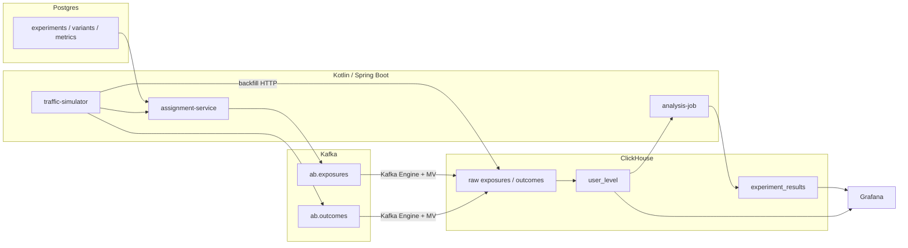

# A/B Experiments Platform

**Схема:**



Платформа экспериментов для checkout: конфиг в **Postgres**, детерминированное назначение варианта, события в **Kafka**, user-level факты в **ClickHouse** и решение `ship` / `stop` / `hold` на **Grafana**.

Симулятор закладывает известный эффект, поэтому после старта три эксперимента читаются по-разному:

| Эксперимент | Заложенный эффект | Решение |
|---|---|---|
| `checkout_cta` | конверсия +8 п.п., выручка +5% | ship |
| `free_shipping` | конверсия без изменений, доля возвратов +7 п.п. | stop |
| `aa_checkout` | A/A, эффекта нет | hold |

**Ключевые возможности:**
- ✅ Sticky bucketing: `murmur3_32(salt:user_id) % 10000`, веса вариантов делят бакеты внутри `traffic_pct`
- ✅ Первая экспозиция сохраняется: `ReplacingMergeTree` с версией «чем раньше, тем больше»
- ✅ Окно атрибуции 1 час после экспозиции, ковариата CUPED — выручка за 7 дней до неё
- ✅ Wald z-тест и 95% интервал для конверсии, выручки и возвратов
- ✅ SRM: хи-квадрат размеров групп против весов 50/50
- ✅ CUPED для выручки
- ✅ Решение: `stop`, если guardrail просел минимум на 2 п.п. и значим; `ship`, если основная метрика выросла минимум на 2 п.п. и значима; иначе `hold`
- ✅ Backfill 8 000 пользователей на эксперимент за 14 дней, чтобы график не был пустым
- ✅ Живой трафик идёт через assignment API и Kafka

---

## Технологический стек

| Компонент | Технология | Роль |
|---|---|---|
| Конфиг | PostgreSQL 15 | Эксперименты, варианты, метрики |
| Назначение | Kotlin / Spring Boot | `GET /api/assign` |
| Трафик | Kotlin / Spring Boot | Backfill и живые исходы |
| Брокер | Kafka (Confluent 7.5) | `ab.exposures`, `ab.outcomes` |
| Аналитика | ClickHouse 23.8 | Raw, user-level, решения |
| Статистика | Kotlin + Commons Math | z-тест, SRM, CUPED |
| Дашборд | Grafana 10 | Решения, лифт, конверсия по дням |

Grafana подключает плагин ClickHouse из `iot-pipeline/grafana/plugins` этого же репозитория.

---

## Как считается решение

Единица анализа — пользователь внутри эксперимента. Популяции трёх экспериментов не пересекаются: `user_id` имеет префикс ключа эксперимента, чтобы заложенные эффекты не смешивались.

- Конверсия и возврат — доли пользователей (биномиальный Wald).
- Выручка — среднее на пользователя, интервал через дельта-метод по выборочной дисперсии.
- CUPED: `Y - θ(X - mean(X))`, `θ = Cov(Y, X) / Var(X)` на объединённой выборке. `X` — выручка за 7 дней до экспозиции.
- SRM с p-value ниже 0.001 оставляет решение `hold`.
- Меньше 500 пользователей в группе — тоже `hold`.

Порог значимости 0.05. Горизонт фиксированный: job пересчитывает оценку раз в минуту, но не использует последовательный анализ.

---

## Требования

- Docker 20.10+ и Docker Compose 2+
- JDK 17+ для сборки JAR

---

## Быстрый старт

Из корня монорепо:

```bash
./gradlew :ab-experiments-platform:platform-lib:test \
  :ab-experiments-platform:assignment-service:bootJar \
  :ab-experiments-platform:traffic-simulator:bootJar \
  :ab-experiments-platform:analysis-job:bootJar

cd ab-experiments-platform
docker compose up -d
```

Backfill заканчивается до того, как `traffic-simulator` становится healthy. `analysis-job` стартует следом и в течение минуты пишет `ab.experiment_results`.

Остановка:

```bash
docker compose stop
docker compose down
docker compose down -v
```

`down -v` удаляет Postgres, ClickHouse и Grafana. Следующий запуск снова прогоняет сиды и backfill.

---

## Интерфейсы

| Сервис | URL | Учётные данные |
|---|---|---|
| Grafana | http://localhost:3009 | `admin` / `admin` |
| Assignment | http://localhost:8092/api/assign?experiment_key=checkout_cta&user_id=demo-user | — |
| ClickHouse HTTP | http://localhost:8129 | `admin` / `admin123` |
| Postgres | `localhost:54329`, база `ab` | `admin` / `admin123` |
| Kafka UI | http://localhost:8093 | — |

Дашборд называется **A/B experiments**. На нём таблица решений, метрики с интервалами и CUPED, дневная конверсия `checkout_cta` и доля возвратов.

Пример назначения:

```bash
curl 'http://localhost:8092/api/assign?experiment_key=checkout_cta&user_id=demo-user'
```

Повтор того же `user_id` возвращает тот же вариант и не пишет вторую экспозицию, пока жив процесс assignment-service.

---

## Модули

| Модуль | Что делает |
|---|---|
| `platform-lib` | Хеш, генератор исходов, z-тест, SRM, CUPED |
| `assignment-service` | Читает конфиг из Postgres, отдаёт вариант, пишет exposure в Kafka |
| `traffic-simulator` | Кладёт 14 дней истории в ClickHouse и шлёт живые outcomes |
| `analysis-job` | Раз в минуту читает `ab.user_level` и пишет `ab.experiment_results` |

Тест `DecisionTest` прогоняет те же 8 000 пользователей, что и backfill, и проверяет три решения.
