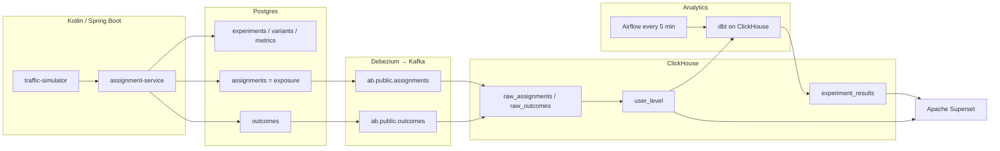
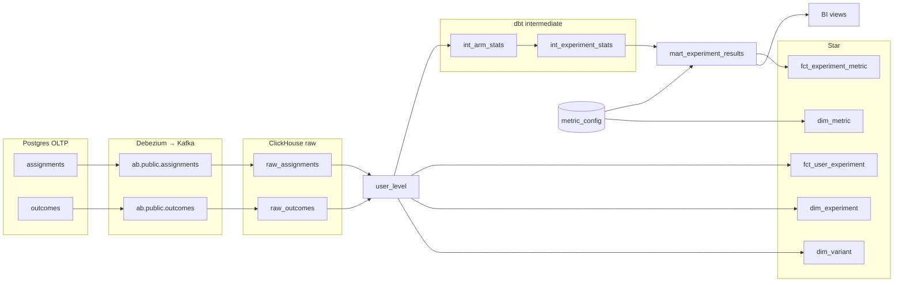
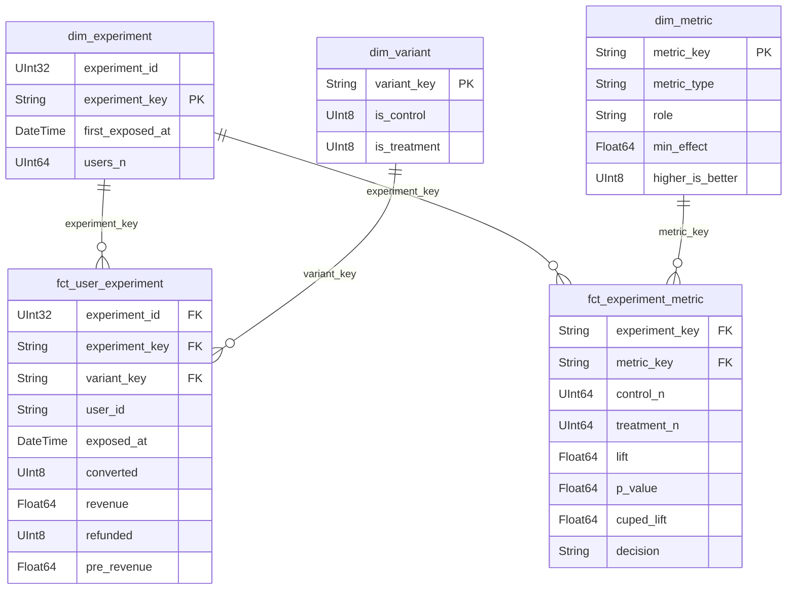
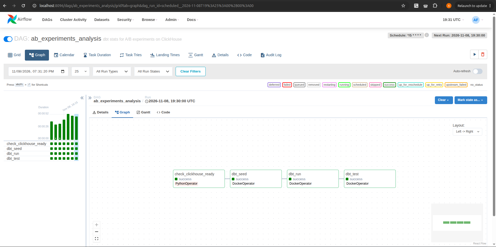
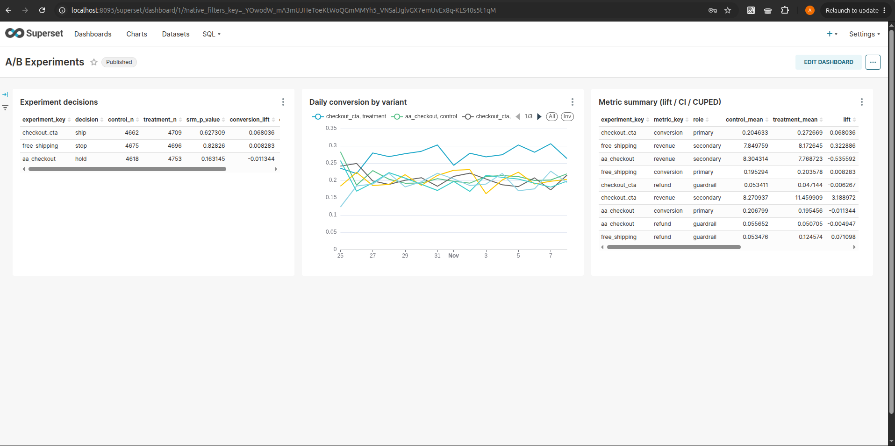

# A/B Experiments Platform

**Схема:**



Платформа A/B: **sticky assignment в Postgres**, CDC через **Debezium**, статистика и решение `ship` / `stop` / `hold` — в **dbt + Airflow** (не в Kotlin-сервисе). BI — **Superset**.

| Эксперимент | Заложенный эффект | Решение |
|---|---|---|
| `checkout_cta` | конверсия +8 п.п. | ship |
| `free_shipping` | возвраты +7 п.п. | stop |
| `aa_checkout` | A/A | hold |

**Ключевые возможности:**
- ✅ API lifecycle: create / start / stop, assign, outcomes
- ✅ Assignment = exposure, SSOT в `assignments`
- ✅ Сервисы не пишут в Kafka — только Debezium CDC
- ✅ dbt: arm stats → Wald / SRM / CUPED → `experiment_results`
- ✅ Airflow DAG `ab_experiments_analysis` каждые 5 минут
- ✅ Superset: decisions, lift/CI/CUPED, daily conversion

---

## Стек

| Компонент | Технология | Роль |
|---|---|---|
| OLTP | PostgreSQL 15 | эксперименты, assignments, outcomes |
| API | Kotlin / Spring Boot | assign + lifecycle |
| CDC | Debezium 2.5 | Postgres → Kafka |
| OLAP | ClickHouse 23.8 | raw, user_level |
| Трансформы | dbt-clickhouse | статистика и decision |
| Оркестрация | Airflow 2.8 | `*/5 * * * *` |
| BI | Superset 3.1 | дашборд |

---

## Lineage



## Star schema



| Модель | Тип | Grain |
|---|---|---|
| `dim_experiment` | dim | `experiment_key` |
| `dim_variant` | dim | `variant_key` |
| `dim_metric` | dim | `metric_key` |
| `fct_user_experiment` | fact | `(experiment_id, user_id)` |
| `fct_experiment_metric` | fact | `(experiment_key, metric_key)` |

---

## Метрики

Каталог и пороги — seed `dbt/seeds/metric_config.csv` (зеркало в Postgres `metrics`).  
Единица анализа — sticky assignment (`user_level`): один ряд на `(experiment, user)`.

| Метрика | Тип | Роль | Определение на user-level | Baseline (demo) | `min_effect` | `higher_is_better` |
|---|---|---|---|---|---|---|
| `conversion` | binomial | **primary** | доля пользователей с ≥1 `conversion` в окне 1 ч после exposure | 20% | +2 п.п. (`0.02`) | да |
| `revenue` | continuous | secondary | сумма `revenue` в том же окне 1 ч; CUPED по `pre_revenue` (−7 дней … exposure) | ~40 на конверт | 0 | да |
| `refund` | binomial | **guardrail** | доля с ≥1 `refund` в окне 1 ч | 5% | +2 п.п. (`0.02`) | нет (рост — плохо) |

**Атрибуция:** окно post-exposure = 1 час (как в `user_level`; в OLTP `attribution_window_seconds = 3600`).  
Pre-period для CUPED по revenue: 7 дней до `assigned_at`.

### Оценка эффекта

| Шаг | Что считается |
|---|---|
| Lift | `treatment_mean − control_mean` (для binomial — разница долей) |
| Wald 95% CI / p-value | `α = 0.05`, z ≈ 1.96; для binomial дисперсия `p(1−p)`, для revenue — sample variance |
| SRM | χ² на размеры arms vs веса 50/50; алерт если `srm_p_value < 0.001` |
| CUPED | только `revenue`: корректировка на `pre_revenue`, θ из pooled cov; даёт `cuped_lift` / CI / p |
| MDE / significance | «beneficial» / «harmful»: `p < 0.05` **и** `|lift| ≥ min_effect` в нужную сторону |

### Decision (`ship` / `stop` / `hold`)

На уровне эксперимента (не метрики):

1. `hold` — если `n_control < 500` или `n_treatment < 500`, либо SRM failed  
2. `stop` — если **guardrail** (`refund`) statistically harmful  
3. `ship` — если **primary** (`conversion`) statistically beneficial  
4. иначе `hold` (secondary `revenue` на decision не влияет, только в отчёте / CUPED)

### Planted-эффекты в демо

Базовые ставки control: conversion 20%, refund 5%, revenue ~40 на покупку. Treatment добавляет lifts из sampler:

| Эксперимент | Planted lift | Ожидаемое решение |
|---|---|---|
| `checkout_cta` | conversion **+8 п.п.**, revenue **+5%** rel. | `ship` (primary бьёт MDE 2 п.п.) |
| `free_shipping` | refund **+7 п.п.** | `stop` (guardrail вреден) |
| `aa_checkout` | без эффектов (A/A) | `hold` |

Runtime-статистика и decision — SQL в dbt; planted lifts живут в demo-каталогах `assignment-service` / `traffic-simulator`.

---

## API

База: `http://localhost:8092`

| Метод | Путь | Назначение |
|---|---|---|
| `GET`/`POST` | `/api/experiments` … `/start` `/stop` | lifecycle |
| `GET`/`POST` | `/api/assign?experiment_key=&user_id=` | sticky assign |
| `POST` | `/api/outcomes` / `/batch` | исходы |
| `POST` | `/api/admin/backfill` | демо 14 дней |

---

## Быстрый старт

```bash
./gradlew :ab-experiments-platform:assignment-service:test \
  :ab-experiments-platform:assignment-service:bootJar \
  :ab-experiments-platform:traffic-simulator:bootJar

cd ab-experiments-platform
docker compose up -d --build
```

После backfill и CDC Airflow поднимет DAG и прогонит dbt. Первый успешный run появится в `ab.experiment_results` и на дашборде Superset.

Ручной прогон dbt:

```bash
docker compose run --rm dbt seed --full-refresh
docker compose run --rm dbt run
docker compose run --rm dbt test
```

---

## Интерфейсы

| Сервис | URL | Учётки |
|---|---|---|
| Superset | http://localhost:8095 | `admin` / `admin` |
| Airflow | http://localhost:8096 | `admin` / `admin` |
| Assignment API | http://localhost:8092 | — |
| Debezium | http://localhost:8094 | — |
| ClickHouse | http://localhost:8129 | `admin` / `admin123` |
| Postgres | `localhost:54329` / `ab` | `admin` / `admin123` |
| Kafka UI | http://localhost:8093 | — |




---

## Модули

| Модуль | Роль |
|---|---|
| `assignment-service` | API + Postgres SSOT, бакет, демо-backfill |
| `traffic-simulator` | live-трафик через HTTP |
| `dbt/` | статистика и витрины |
| `airflow/dags/` | расписание dbt |
| `debezium/` | CDC connector |
| `superset/` | bootstrap дашборда |
