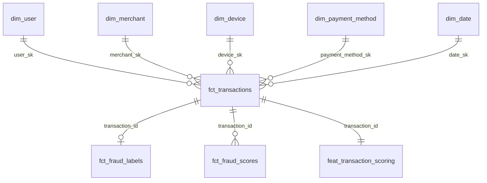

# Payment Fraud Scoring Platform

**Стек:** Apache Kafka • ClickHouse • dbt • CatBoost • Kotlin / Spring Boot • Apache Airflow • Apache Superset • Grafana

```mermaid
flowchart LR
  Gen["Transaction Generator<br/>Kotlin Spring Boot"] -->|payments.*| K[("Kafka")]
  K --> CH["ClickHouse<br/>Kafka Engine + MV"]
  CH --> DBT["dbt<br/>staging → dims → facts → features → marts"]
  DBT --> Train["CatBoost train<br/>Kotlin ml-jobs + CLI"]
  Train --> model registry[("versioned model registry (Docker volume)")]
  model registry --> API["Scoring API<br/>Kotlin Spring Boot"]
  DBT --> API
  API -->|payments.scores| K
  AF["Airflow"] --> DBT
  AF --> Train
  AF --> Score["Batch score"]
  Score --> K
  CH --> SS["Superset"]
  CH --> GR["Grafana"]
```

End-to-end antifraud контур: синтетические платежи и лейблы в Kafka, dimensional DWH + **feature store** в ClickHouse, обучение **CatBoost**, online/batch scoring, мониторинг качества модели и fraud ops метрик.

**Чем отличается от других проектов портфолио**
- Clickstream: rule-based Flink fraud → здесь **ML scoring + feature store**
- Fintech marts: fraud *indicators* → здесь полный цикл **train → promote → serve**

## Ключевые возможности

- ✅ Kafka topics: `payments.transactions` / `labels` / `scores` / `users` / `merchants`
- ✅ ClickHouse Kafka Engine + Materialized Views → landing MergeTree
- ✅ dbt-слои: staging → intermediate → dimensions → facts → **features** → marts
- ✅ Star schema + SCD Type 2 на `dim_user`
- ✅ Point-in-time фичи (velocity окна только по `event_ts < current`)
- ✅ CatBoostClassifier с native categoricals, time-based split, AUC / PR-AUC / Recall@1% FPR
- ✅ Model registry в model registry (`latest.json` + versioned artifacts), promotion gate по AUC
- ✅ FastAPI `/score` (near-real-time) + batch score в Kafka
- ✅ Decision policy: `ALLOW` / `CHALLENGE` / `BLOCK`
- ✅ Airflow DAG `fraud_scoring_daily`: dbt layers → train → score → refresh marts
- ✅ Superset «Fraud Scoring Ops» + Grafana «Fraud Model Health»
- ✅ Один `docker compose up --build`

## Технологический стек

| Компонент | Технология | Описание |
|-----------|------------|----------|
| Event source | Kotlin Spring Boot generator | 7 fraud patterns + label lag |
| Broker | Kafka (Confluent 7.5) | payments.* topics |
| OLAP / Feature Store | ClickHouse 23.8 | landing + dbt models |
| Transforms | dbt-core + dbt-clickhouse | star schema + feature layer |
| Model | CatBoost 1.2 (CLI train + JVM predict) | tabular fraud classifier |
| Artifacts | Docker volume `/models` | versioned `.cbm` + metrics |
| Serving | Kotlin Spring Boot | online score by `transaction_id` |
| Orchestration | Airflow 2.8 | DockerOperator layers |
| BI | Superset 3.1 + Grafana 10 | ops + model health |

## Требования

- Docker 20.10+
- Docker Compose 2.0+
- ~8 GB RAM рекомендуется (feature build + CatBoost)

## Быстрый старт

```bash
cd fraud-scoring-platform
docker compose up -d --build
```

**Что произойдёт автоматически:**
1. Поднимутся Zookeeper, Kafka, ClickHouse, model registry
2. `generator` зальёт справочники и ~12k исторических транзакций, затем стримит live-события
3. `bootstrap` дождётся данных → `dbt run` (все слои) → `train.py` → `score_batch.py`
4. Поднимутся Scoring API, Airflow, Superset, Grafana

Первый прогон bootstrap может занять **10–20 минут** (ожидание данных + feature table + train).

### Проверка scoring API

```bash
# health
curl -s http://localhost:8085/health | jq .

# взять любой transaction_id из ClickHouse и проскорить
TX=$(curl -s 'http://localhost:8123/?user=admin&password=admin123' \
  --data-binary "SELECT transaction_id FROM fraud.feat_transaction_scoring LIMIT 1")
curl -s -X POST http://localhost:8085/score \
  -H 'Content-Type: application/json' \
  -d "{\"transaction_id\": \"$TX\"}" | jq .
```

Остановка:

```bash
docker compose down          # сохранить volumes
docker compose down -v       # полный сброс
```

## URL сервисов

| Сервис | URL | Credentials |
|--------|-----|-------------|
| Scoring API | http://localhost:8085/docs | — |
| Airflow | http://localhost:8081 | admin / admin |
| Superset | http://localhost:8090 | admin / admin |
| Grafana | http://localhost:3000 | admin / admin |

> **Grafana:** если datasource пустой — вручную поставьте плагин `grafana-clickhouse-datasource` (Connections → Add new connection → ClickHouse).

> Grafana: установите плагин `grafana-clickhouse-datasource` в UI (Connections → Add new connection), если дашборд не подхватывает datasource автоматически.
| Kafka UI | http://localhost:8088 | — |
| ClickHouse HTTP | http://localhost:8123 | admin / admin123 |

## Модель данных (star schema)



| Таблица | Зерно |
|--------|--------|
| `fct_transactions` | 1 платёж |
| `fct_fraud_labels` | 1 лейбл на tx |
| `fct_fraud_scores` | 1 score на `(tx, model_version)` |
| `feat_transaction_scoring` | 1 строка фич на tx (PIT) |
| `dim_user` | SCD2 (risk_tier versions) |

## dbt lineage

```
landing_* 
  → stg_* 
  → int_transactions_enriched / int_user_amount_stats
  → dim_* + fct_*
  → feat_transaction_scoring
  → mart_fraud_ops / mart_model_performance / mart_feature_drift
     / mart_high_risk_segments / mart_label_lag
```

### Feature store (ключевые фичи)

| Группа | Примеры |
|--------|---------|
| Velocity | `user_tx_cnt_1h/24h/7d`, `device_tx_cnt_1h`, `merchant_tx_velocity_1h` |
| Amount | `amount_zscore_user`, `amount_vs_user_p95`, `user_amount_sum_24h` |
| Novelty | `is_new_device`, `is_new_device_30d`, `is_new_pm_7d` |
| Geo / channel | `is_foreign_ip`, `is_cross_border`, `is_3ds` |
| Categorical | `cat_mcc`, `cat_channel`, `cat_ip_country`, `cat_device_os`, … |

Лейбл `label_is_fraud` лежит в feature-таблице **только для train export** и не подаётся в модель.

## Fraud patterns в генераторе

1. `velocity` — серия tx с одного device
2. `amount_outlier` — сумма намного выше типичной для user
3. `geo_jump` — смена `ip_country`
4. `new_device_high_amount` — новый device + крупная сумма
5. `merchant_mule` — high-risk MCC / merchant
6. `card_testing` — микро-авторизации
7. `account_takeover` — новый device + foreign IP + atypical amount

Часть лейблов immediate (`manual_review`), часть delayed (`chargeback`) — для демо label lag.

## ML / serving

**Train** (`ml-jobs` (`train`)):
- читает labeled rows из `feat_transaction_scoring`
- time-based split 70/15/15
- CatBoost `Logloss` + `auto_class_weights=Balanced`
- пишет `/models/fraud-models/{version}/` и при AUC ≥ 0.75 промоутит в `latest/`

**Batch score** (`ml-jobs` (`score-batch`)):
- unscored tx → Kafka `payments.scores` → ClickHouse landing

**Online** (Kotlin Spring Boot `POST /score`):
- тянет фичи из CH по `transaction_id`
- возвращает `{score, decision, model_version, top_features, latency_ms}`

Decision thresholds (configurable in `ml/feature_config.yml`):
- `score ≥ 0.9` → **BLOCK**
- `score ≥ 0.7` → **CHALLENGE**
- else → **ALLOW**

## Airflow DAG

`fraud_scoring_daily` (`@hourly`):

```
check_clickhouse
  → staging → intermediate → dimensions → facts → features → marts
  → dbt_test → train_catboost → batch_score → refresh_marts
```

## Структура проекта

```
fraud-scoring-platform/
├── docker-compose.yml
├── generator/                 # Kotlin Spring Boot — синтетика платежей + лейблов
├── clickhouse/                # Kafka Engine + MV + landing DDL
├── dbt/models/{staging,intermediate,dimensions,facts,features,marts}
├── ml-jobs/                   # Kotlin Spring Boot — train + score-batch (CatBoost CLI + JVM predict)
├── scoring-service/           # Kotlin Spring Boot — online /score
├── airflow/dags/              # fraud_scoring_daily
├── superset/                  # dashboard bootstrap
├── grafana/provisioning/      # model health dashboard
└── scripts/bootstrap.sh       # first-run: dbt + train + score
```

## Полезные команды

```bash
# ручной dbt
docker compose run --rm dbt run --select tag:features
docker compose run --rm dbt test

# переобучить модель (Kotlin)
docker compose run --rm --entrypoint java ml-jobs -jar /app/app.jar train

# batch score
docker compose run --rm --entrypoint java ml-jobs -jar /app/app.jar score-batch

# логи bootstrap
docker compose logs -f bootstrap
```


## Kotlin / Spring Boot apps

Все прикладные сервисы написаны на **Kotlin + Spring Boot 3** (как в остальных проектах портфолио):

| Модуль | Gradle | Роль |
|--------|--------|------|
| `generator` | `:fraud-scoring-platform:generator` | Kafka producer синтетики |
| `ml-jobs` | `:fraud-scoring-platform:ml-jobs` | `train` / `score-batch` |
| `scoring-service` | `:fraud-scoring-platform:scoring-service` | HTTP `/score`, `/health` |

**Обучение CatBoost:** официальный JVM-пакет умеет только *inference* (`catboost-prediction`). Fit выполняется через **CatBoost CLI** (`catboost fit`), который оркестрирует Kotlin-job (export из ClickHouse → CLI → registry). Это не Python-runtime.

**Сборка JAR (из корня репо):**
```bash
./gradlew :fraud-scoring-platform:generator:bootJar \
          :fraud-scoring-platform:ml-jobs:bootJar \
          :fraud-scoring-platform:scoring-service:bootJar
```

Остаются не-Kotlin (инфраструктура, не бизнес-код приложения): dbt, Airflow DAG, Superset bootstrap.

## Что демонстрирует проект

1. **ClickHouse as feature store** — PIT агрегаты рядом с dimensional DWH  
2. **dbt layered ELT** + tests на гранях  
3. **MLOps glue** — Airflow + versioned model registry + promotion gate  
4. **Dual serving** — batch Kafka scores + low-latency API  
5. **Observability** — ops KPIs (Superset) + model/drift (Grafana)  

## Чеклист реализации

- [x] Generator с fraud patterns + label lag  
- [x] ClickHouse Kafka Engine + landing  
- [x] dbt star schema + SCD2 + feature layer + marts  
- [x] CatBoost train / promote / batch score  
- [x] FastAPI scoring service  
- [x] Airflow layered DAG  
- [x] Superset + Grafana bootstrap  
- [x] Docker Compose one-command demo  
