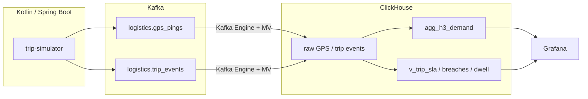

# Logistics Control Tower

**Схема:**



Операционный контур last-mile доставки: симулятор рейсов пишет GPS-пинги и lifecycle-события в **Kafka**, **ClickHouse** собирает гексагоны **H3** и SLA-витрины, **Grafana** показывает карту и рейсы вне SLA.

Симулятор закладывает сценарии, поэтому после старта дашборд сразу читается:

| Сценарий | Что видно |
|---|---|
| Нормальный рейс | точка на карте, SLA OK |
| Опоздание к drop | строка в «Trips outside SLA» |
| Долгий простой у склада | таблица dwell ≥ 10 мин |
| Плотность спроса | H3 heatmap / table |

**Ключевые возможности:**
- Симулятор рейсов: GPS каждые ~5 с, 4 склада (геозоны), простой и опоздания
- Ingestion из Kafka через Kafka Engine + Materialized Views
- Гексагоны H3 (`geoToH3`, resolution 9) и 15-минутные агрегаты спроса
- Витрины: ETA / late_sec, рейсы вне SLA, dwell у склада, активные позиции
- Grafana: geomap активных рейсов, таблица нарушителей SLA, H3 density

---

## Технологический стек

| Компонент | Технология | Роль |
|---|---|---|
| Симулятор | Kotlin / Spring Boot | Рейсы, GPS, события |
| Брокер | Kafka (Confluent 7.5) | `logistics.gps_pings`, `logistics.trip_events` |
| Аналитика | ClickHouse 23.8 | Raw, H3, SLA-витрины |
| Дашборд | Grafana 10 | Карта, SLA, dwell, H3 |

Grafana подключает плагин ClickHouse из `iot-pipeline/grafana/plugins` этого же репозитория.

---

## Быстрый старт

Из корня репозитория соберите JAR, затем поднимите compose:

```bash
./gradlew :logistics-control-tower:trip-simulator:bootJar
cd logistics-control-tower
docker compose up --build -d
```

| Сервис | URL | Логин |
|---|---|---|
| Grafana | http://localhost:3010 | `admin` / `admin` |
| ClickHouse HTTP | http://localhost:8130 | `admin` / `admin123` |
| Kafka UI | http://localhost:8094 | — |
| Simulator health | http://localhost:8095/actuator/health | — |

Дашборд: **Logistics Control Tower** (откроется через несколько минут после backfill и первых live-тиков).

Проверка данных:

```bash
curl -s 'http://localhost:8130/?user=admin&password=admin123' \
  --data-binary "SELECT count() FROM logistics.raw_gps_pings"
```

Остановка:

```bash
docker compose down
```

---

## Модель данных (кратко)

- `raw_gps_pings` — пинги курьера (`trip_id`, lat/lon, speed, time)
- `raw_trip_events` — `ASSIGNED`, `EN_ROUTE_*`, `AT_WAREHOUSE`, `GEOFENCE_*`, `DELIVERED` + `promised_eta`
- `agg_h3_demand` — SummingMergeTree по `geoToH3(lon, lat, 9)` и 15-минутным окнам
- `v_trip_sla` / `v_sla_breaches` / `v_warehouse_dwell` / `v_active_positions` — операционные витрины
