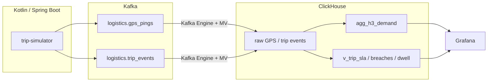
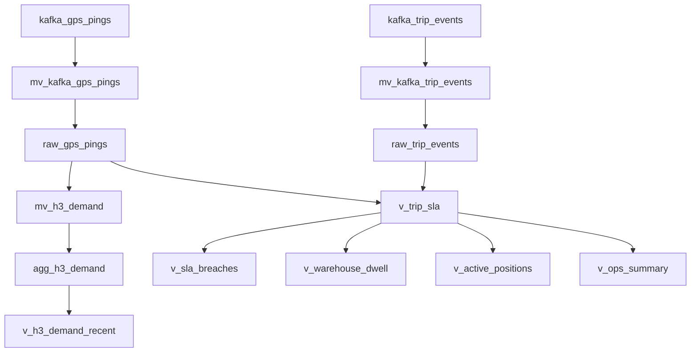
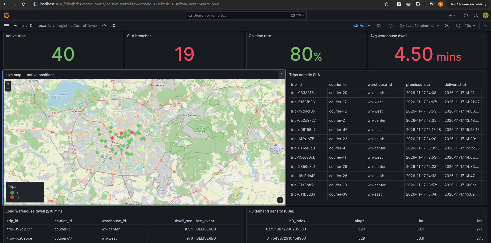

# Logistics Control Tower

Портфолио-демо операционного **control tower** для last-mile доставки: от GPS-пингов курьера до карты, SLA и плотности спроса в near-real-time.

## Постановка проблемы

В городской доставке диспетчер и ops-команда живут не отчётами «за вчера», а вопросами **прямо сейчас**:

| Вопрос | Почему Excel / batch DWH не хватает |
|---|---|
| Где курьеры и какие рейсы «горят»? | GPS приходит каждые несколько секунд; снимок за час уже устарел |
| Кто вышел за обещанный ETA? | Нужен join жизненного цикла рейса с `promised_eta`, не только точки на карте |
| Где простой у склада? | Опоздание часто рождается на dwell (ожидание выдачи), а не на дороге |
| Где сейчас спрос / нагрузка по району? | Сырые lat/lon плохо агрегируются; нужна устойчивая гео-сетка |

Типичные провалы без control tower:

- смотрят только трек на карте → не видят **SLA** и обещанное время;
- считают опоздание по статусу «доставлено» раз в сутки → **активные** нарушители уже у клиента с претензией;
- спрос рисуют по почтовым индексам → границы кривые, join с пингами неудобен;
- всё пишут синхронно в OLTP → аналитика душит операционку.

Нужен контур: **события рейса → поток → OLAP → операционные витрины → карта и алерты**, с задержкой секунд–минут, а не часов.

## Что решает этот проект

Демо показывает **сквозной data-путь** control tower и отвечает на вопросы:

1. **Как принять поток GPS и статусов?** — симулятор рейсов пишет в Kafka (`gps_pings`, `trip_events`).
2. **Как не строить тяжёлый ETL?** — ClickHouse **Kafka Engine + Materialized Views** кладут сырьё в MergeTree.
3. **Как агрегировать географию?** — `geoToH3(lon, lat, 9)` → плотность спроса по гексагонам.
4. **Как посчитать SLA и простой?** — SQL-витрины: `late_sec`, `sla_breached`, dwell между `AT_WAREHOUSE` и выездом, активные позиции.
5. **Где смотреть?** — Grafana: geomap (OpenStreetMap), таблица нарушителей SLA, long dwell, H3 heatmap.

Симулятор **закладывает сценарии**, чтобы дашборд читался сразу после старта:

| Сценарий | Что видно на Grafana |
|---|---|
| Нормальный рейс | точка на карте, SLA OK |
| Опоздание к drop | строка в «Trips outside SLA», красный статус |
| Долгий простой у склада | таблица dwell ≥ 10 мин |
| Плотность спроса | H3 heatmap / table по Минску |

**В скоупе:** streaming ingest, geo (H3), SLA/ETA/dwell-витрины, операционный дашборд.  
**Вне скоупа:** TMS/WMS, оптимизация маршрутов, push-уведомления курьерам, ML-прогноз ETA — учебный каркас control tower, не полный Dispatch.

**Ключевые возможности:**
- симулятор: ~40 live-рейсов, 4 склада с геозонами, GPS ~каждые 5 с, backfill ~3 ч истории;
- lifecycle: `ASSIGNED → EN_ROUTE_PICKUP → AT_WAREHOUSE → EN_ROUTE_DROP → DELIVERED` (+ geofence enter/exit);
- ingestion: Kafka Engine + MV → `raw_gps_pings` / `raw_trip_events`;
- H3 resolution 9 + 15-минутные окна в `agg_h3_demand` (SummingMergeTree);
- витрины: ETA / late_sec, SLA breaches, warehouse dwell, active positions, ops summary;
- Grafana geomap на бесплатных тайлах OpenStreetMap (без Carto API key).

## Архитектура



Почему такой выбор стека:

| Решение | Зачем |
|---|---|
| Kafka как шина | симулятор (как и реальный трекер) не ходит в OLAP напрямую; at-least-once доставка событий |
| ClickHouse Kafka Engine + MV | ingestion без отдельного Flink/Spark-джоба; сырьё сразу в колоночном хранилище |
| H3 вместо сетки lat/lon | стабильные ячейки для heatmap спроса, удобный rollup по району |
| SQL-views для SLA | операционные метрики пересчитываются при чтении дашборда; без Airflow/dbt |
| Grafana | geomap + таблицы алертов рядом с метриками; привычный ops-интерфейс |

## Стек

| Компонент | Технология | Роль |
|---|---|---|
| Симулятор | Kotlin / Spring Boot | рейсы, GPS, lifecycle, backfill |
| Брокер | Kafka (Confluent 7.5) | `logistics.gps_pings`, `logistics.trip_events` |
| OLAP | ClickHouse 23.8 | raw, H3, SLA-витрины |
| BI | Grafana 10 | карта, SLA, dwell, H3 |

Плагин ClickHouse для Grafana монтируется из `iot-pipeline/grafana/plugins`.

---

## Домен и симулятор

Синтетика: один город — **Минск** (~53.9N, 27.5E), 4 склада (геозона ≈ 200 м):

| ID | Склад |
|---|---|
| `wh-center` | Центр |
| `wh-east` | Восток |
| `wh-west` | Запад |
| `wh-south` | Юг |

Фазы рейса и события:

```text
ASSIGNED
  → EN_ROUTE_PICKUP
  → GEOFENCE_ENTER / AT_WAREHOUSE   ← старт dwell
  → GEOFENCE_EXIT / EN_ROUTE_DROP   ← конец dwell
  → DELIVERED
```

Сценарии (`TripScenario`): `NORMAL`, `LATE` (завышенный `promised_eta` / длинный drop), `LONG_DWELL` (dwell ≥ ~12 мин). При старте: backfill завершённых рейсов за `backfill-hours` + пул live-рейсов (`active-trips`, по умолчанию 40).

Топики:

| Топик | Зерно | Поля (суть) |
|---|---|---|
| `logistics.gps_pings` | один пинг | `trip_id`, `courier_id`, `warehouse_id`, `lat`, `lon`, `speed_kmh`, `ts` |
| `logistics.trip_events` | одно событие lifecycle | `trip_id`, `event_type`, `promised_eta`, `lat`, `lon`, `ts` |

---

## Модель данных в ClickHouse



| Объект | Назначение |
|---|---|
| `raw_gps_pings` | сырые пинги, partition по дню |
| `raw_trip_events` | lifecycle + `promised_eta` |
| `agg_h3_demand` | SummingMergeTree: пинги по `h3_index` × 15 мин |
| `v_h3_demand_recent` | плотность за последний час (+ lat/lon центра ячейки) |
| `v_trip_sla` | ETA, `late_sec`, `sla_breached`, `dwell_sec`, последняя точка |
| `v_sla_breaches` | только нарушители |
| `v_warehouse_dwell` | простой; `long_dwell` при ≥ 600 с |
| `v_active_positions` | не `DELIVERED`, пинг за последние 30 мин → слой карты |
| `v_ops_summary` | active / breaches / on-time rate / avg dwell |

Логика SLA (упрощённо):

- если есть `DELIVERED` — breach, когда факт > `promised_eta`;
- если рейс ещё в пути и `now > promised_eta` — тоже breach (операционный алерт, не только post-factum);
- dwell = время от `AT_WAREHOUSE` до `EN_ROUTE_DROP` (или до `now`, если ещё на складе).

---

## Дашборд Grafana

Дашборд **Logistics Control Tower** (`uid: logistics-control-tower`):

| Панель | Источник |
|---|---|
| Active trips / SLA breaches / On-time rate / Avg dwell | `v_ops_summary` |
| Live map — active positions | `v_active_positions` (geomap, цвет по `sla_breached`) |
| Trips outside SLA | `v_sla_breaches` |
| Long warehouse dwell | `v_warehouse_dwell` |
| H3 demand density + map | `v_h3_demand_recent` |

Basemap: **OpenStreetMap** XYZ-тайлы (дефолтный Carto в Grafana 10 требует API key — в compose задан `GF_GEOMAP_DEFAULT_BASELAYER_CONFIG`).

---

## Быстрый старт

Из корня репозитория:

```bash
./gradlew :logistics-control-tower:trip-simulator:bootJar
cd logistics-control-tower
docker compose up --build -d
```

| Сервис | URL | Логин |
|---|---|---|
| Grafana | http://localhost:3010 | `admin` / `admin` |
| ClickHouse HTTP | http://localhost:8130 | `admin` / `admin123` |
| Kafka UI | http://localhost:8094 | — |
| Simulator health | http://localhost:8095/actuator/health | — |

Дашборд: **Logistics Control Tower** — после backfill и первых live-тиков (обычно < 1–2 мин).


Проверка данных вручную:

```bash
curl -s 'http://localhost:8130/?user=admin&password=admin123' \
  --data-binary "SELECT * FROM logistics.v_ops_summary"
```

Остановка:

```bash
docker compose down
```

---

## Структура каталога

```text
logistics-control-tower/
  docker-compose.yml
  trip-simulator/          # Spring Boot: симуляция рейсов → Kafka
  clickhouse/
    01-raw.sql             # Kafka Engine + MV → raw
    02-h3.sql              # geoToH3, agg_h3_demand
    03-sla.sql             # SLA / dwell / active / summary views
  grafana/provisioning/    # datasource + dashboard
  scripts/acceptance.sh
  README.md
```
