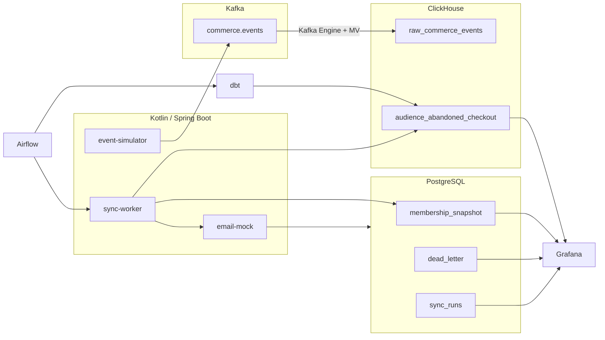

# Reverse ETL · Abandoned Checkout

**Схема:**



Активация аудитории «бросил оформление заказа»: dbt считает **желаемое** членство, sync-worker строит changelog относительно прошлого снимка в PostgreSQL и доставляет `enter` / `leave` / `update` в мок email-сервиса. Покупка или истечение окна снимает человека с цепочки.

Симулятор закладывает сценарии, поэтому после старта дашборд сразу читается:

| Сценарий | Что видно |
|---|---|
| Checkout без purchase | enter в аудиторию |
| Purchase после checkout | leave |
| Смена email / корзины | update |
| Битый email | 422 → dead-letter |
| 429 от email API | dead-letter, следующий прогон идёт дальше |
| Повтор с тем же version | идемпотентный duplicate, без второй подписки |

**Ключевые возможности:**
- Генератор: просмотры, корзина, оформление, заказ, поздние события, битый email
- Ingestion из Kafka через Kafka Engine + Materialized Views
- dbt: профиль клиента и аудитория `abandoned_checkout` как желаемое состояние
- Changelog синка: enter, leave, update относительно прошлого снимка
- Kotlin-воркер доставляет пачки в HTTP API email-сервиса, состояние членства лежит в PostgreSQL
- Идемпотентность по `user_id` + аудитория + action + version
- Dead-letter для 429 и отклонённых строк
- Airflow: витрина (dbt) → test → доставка (HTTP sync)
- Grafana: лаг синка, размер пачки, ошибки, повторные доставки

---

## Технологический стек

| Компонент | Технология | Роль |
|---|---|---|
| Симулятор | Kotlin / Spring Boot | События воронки |
| Брокер | Kafka (Confluent 7.5) | `commerce.events` |
| Аналитика | ClickHouse 23.8 | Raw + dbt mart |
| Трансформации | dbt-clickhouse | Desired audience |
| Оркестрация | Apache Airflow 2.8 | dbt → sync |
| Состояние синка | PostgreSQL 15 | membership, DLQ, runs |
| Email API | Kotlin mock | 200 / 422 / 429 |
| Дашборд | Grafana 10 | Ops + audience |

Grafana подключает плагин ClickHouse из `iot-pipeline/grafana/plugins` этого же репозитория.

---

## Быстрый старт

Из корня репозитория соберите JAR, затем поднимите compose:

```bash
./gradlew :reverse-etl-abandoned-checkout:event-simulator:bootJar \
  :reverse-etl-abandoned-checkout:email-mock:bootJar \
  :reverse-etl-abandoned-checkout:sync-worker:bootJar

cd reverse-etl-abandoned-checkout
# Airflow нужен доступ к docker.sock — GID группы docker на хосте
export DOCKER_GID=$(getent group docker | cut -d: -f3)
docker compose up --build -d
```

Первый прогон dbt ждёт ~45 с накопления событий, затем sync-worker начинает доставку. Контейнер dbt пересобирает витрину каждые 10 минут; Airflow DAG `reverse_etl_abandoned_checkout` оркестрирует `dbt run/test` → HTTP sync.

| Сервис | URL | Логин |
|---|---|---|
| Grafana | http://localhost:3011 | `admin` / `admin` |
| Airflow | http://localhost:8091 | `admin` / `admin` |
| ClickHouse HTTP | http://localhost:8131 | `admin` / `admin123` |
| Kafka UI | http://localhost:8096 | — |
| Simulator health | http://localhost:8097/actuator/health | — |
| Email mock | http://localhost:8098/actuator/health | — |
| Sync worker | http://localhost:8099/actuator/health | — |
| Postgres | localhost:54330 | `admin` / `admin123` / db `retl` |

Дашборд: **Reverse ETL · Abandoned Checkout**.

Ручной sync:

```bash
curl -X POST http://localhost:8099/api/sync/run
```

Проверка данных:

```bash
curl -s 'http://localhost:8131/?user=admin&password=admin123' \
  --data-binary "SELECT count() FROM retl.raw_commerce_events"

curl -s 'http://localhost:8131/?user=admin&password=admin123' \
  --data-binary "SELECT count() FROM retl.audience_abandoned_checkout"
```

Остановка:

```bash
docker compose down
```

---

## Правило аудитории

Пользователь в `audience_abandoned_checkout`, если:

1. Есть `BEGIN_CHECKOUT` за последние 24 часа
2. Checkout старше 2 минут (grace — не писать mid-checkout)
3. Нет `PURCHASE` после этого checkout

`version = sipHash64(user_id, email, cart_value, checkout_at)` — смена атрибутов даёт `update`.
